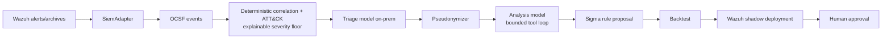
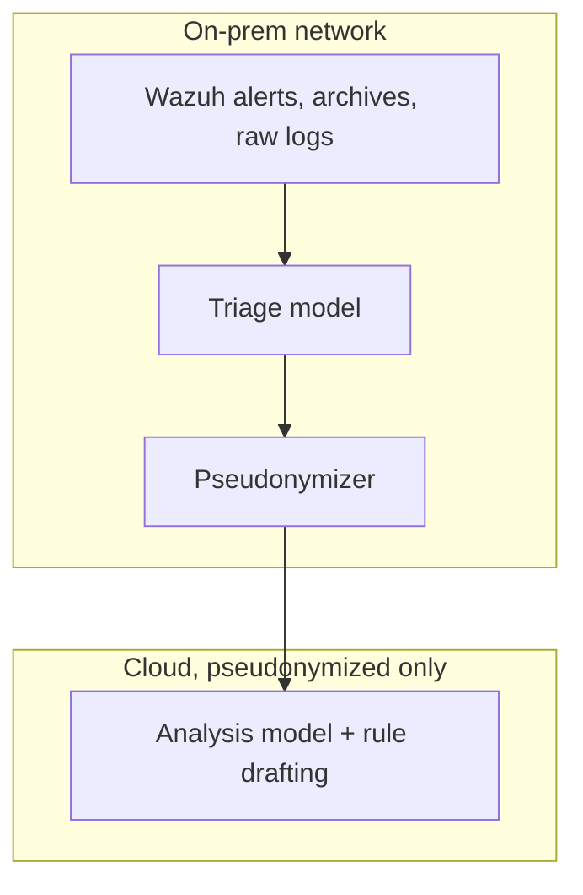

# Project Corvus

On-prem AI SOC analyst for small teams: it turns Wazuh alerts into a few explained attack chains, without logs leaving the network.

> **Status: alpha.** Development happens on the `dev` branch; `main` gets a release only when `dev` is stable. The hackathon submission is frozen at tag `v1.0-submission`. Corvus is model-agnostic: it talks to any OpenAI-compatible chat API (see [Models](#models)).

## The problem

Small teams run Linux servers and Windows endpoints with Wazuh as their only security tool and no 24/7 SOC. Existing AI SOC tools are enterprise-priced SaaS that require shipping raw logs to a vendor cloud. Real attacks stay buried in uncorrelated alerts.

## What it does

Corvus is not a SIEM. It plugs into the Wazuh SIEM the team already runs: Wazuh detects atomic events and stores logs; Corvus consumes alerts, correlates them into attack chains, reasons over them, and pushes learned rules back.





Pipeline, in order (`docs/architecture.md` has the module for each step):

1. Wazuh alerts and archives enter through a `SiemAdapter` (`corvus/adapters/wazuh/`, `corvus/adapters/replay/`). No raw log parsing yet (planned, see `docs/architecture.md`).
2. Alerts become OCSF events (pinned schema v1.9.0). There is no local event store: PostgreSQL is the system of record (incidents, queue, checkpoints, agent steps, rules, dispositions, pseudonyms, spend, LLM attempts; migration `corvus/state/migrations/0002_core_tables.sql`). The SIEM stays the log store, queried on demand.
3. Deterministic correlation (host, user, IP, process, time window) plus MITRE ATT&CK mapping (`corvus/correlate/`, `corvus/attack/`) builds candidate incidents with an explainable severity floor. The database keeps `severity_id` between the floor and one level above it, so models can never silently lower or raise scores.
4. The triage model (on-prem by default) triages each cluster through an async batch queue (`corvus/llm/triage_worker.py`). It alone sees raw evidence.
5. A pseudonymizer (`corvus/guardrails/pseudonymizer.py`) condenses and pseudonymizes the incident before any cloud call.
6. The analysis model reasons over the pseudonymized incident in a bounded agent loop with two read-only tools (`get_events`, `get_attack_technique`) and returns verdict, timeline, and response in English or Spanish (`corvus/llm/agent.py`).
7. Proposed Sigma rules are backtested (`corvus/learning/backtest.py`), deployed to Wazuh in shadow mode (`corvus/learning/wazuh_xml.py`, `corvus/learning/shadow.py`), and need human approval (`corvus rules approve`). Promotion is never a model tool.
8. A reduced web UI (read-only API) and an eval harness sit alongside.

## Models

Corvus is not tied to a model or a vendor. It talks to **any OpenAI-compatible chat-completions API**: you give each purpose a base URL, a model name and, when the endpoint needs one, an API key. Two purposes exist (`corvus/llm/config.py`):

- **Triage** (trust `onprem`): reads the raw evidence and produces the condensed incident. Meant for a model on your own hardware; an `onprem` backend pointing at a public address is refused unless you say so explicitly.
- **Analysis** (trust `cloud`): reasons over the pseudonymized incident in a bounded tool loop and drafts rules. It can be a hosted API or the same local model.

`MODEL_PROFILE` chooses the layout: `hybrid` (default: triage local, analysis on the analysis endpoint), `all-local` (the triage backend serves both, no cloud key needed) or `all-cloud`. Per-purpose `TRIAGE_*` / `ANALYSIS_*` variables override model, base URL, API key, trust and limits.

Requirements on an endpoint: `/v1/chat/completions`, tool calls for the analysis loop, `response_format` of type `json_schema` (strict), and a context window that fits the configured caps. Every configured model also needs a row in `config/price_book.yaml` (price 0 for a local model, declared explicitly); Corvus refuses to start without it.

What has been evaluated: every number in this README was measured with Muse Glimmer 30B (FP8, vLLM, on-prem triage) and `muse-spark-1.3` (analysis), the defaults below. Other models work through the same contract but their quality, validity rate and cost are **not measured here**; run `corvus eval` before trusting one. The names `GLIMMER_BASE_URL` and `META_API_KEY` are historical: you can point both purposes at other endpoints with `TRIAGE_BASE_URL`, `ANALYSIS_BASE_URL`, `ANALYSIS_API_KEY` and the `*_MODEL` variables, but `GLIMMER_BASE_URL` is still a required setting (give it the triage endpoint). Neutral names are on the to-do list.

## Security by design

Every Spark call goes through the pseudonymizer; raw events never leave the on-prem path (`corvus/llm/call.py`, `corvus/guardrails/payload.py`). Supporting guardrails:

- Secret redaction of command-line passwords and tokens before any cloud call (`corvus/guardrails/egress.py`).
- Egress allowlist: the HTTP client only talks to the model endpoints and Wazuh; network-level egress stays the operator's firewall.
- Injection handling: a deterministic pattern detector (`corvus/guardrails/injection.py`) records injection attempts as incident signals; security-validator failures are quarantined, never retried.
- Spend cap (`SPEND_CAP_USD`, default 100.0) with degraded mode; every model attempt is recorded in `llm_attempts`.
- Shadow mode: learned rules run without notifying or changing severity until a human approves; rollback is one command (`corvus/learning/shadow.py`).
- Read-only UI/API: the API serves only `GET` routes plus the UI bundle (`corvus/api/main.py`). The UI has no login; expose it only behind your own access controls.

On the adversarial set v2 (n=57 attacks, one run per fixture, triage by Glimmer and analysis by muse-spark-1.3 as served on 2026-11-02): 10 blocked at triage, 42 judged equal to ground truth, 4 undercalled, 1 overcalled; 0 true positives judged benign and 0 benign fixtures judged true positive; 0 fixtures leaked a canary or prompt marker; 0 out-of-scope tool calls attempted; 0 below the severity floor; 0 hallucinated evidence of 156 cited. Full counts in `eval/reports/adversarial_v2_live_2026-11-02.md`.

Details and attacker model: `docs/threat-model.md`.

### Known limitations

- Non-service usernames join incidents across hosts (`corvus/correlate/identities.py`), so a shared account name — including a name an attacker types into a failed login — links alerts into one incident.
- The pseudonymizer hides only entity-shaped spans of registered values; bare words with no recognizable shape pass through verbatim, as do novel encodings such as compressed payloads or short hex (`corvus/guardrails/pseudonymizer.py`).
- The pseudonymizer registers ordinary words it finds in free text as hosts, and a pseudonym-shaped string typed by an attacker passes through unchanged (`corvus/guardrails/pseudonymizer.py`, `tests/test_pseudonymizer_single_pass.py`).
- Values that are not mapped to a typed slot are kept whole under `unmapped` in the Windows and Wazuh normalizers; the 65536-character cap applies to typed slots and `raw_data` only (`corvus/normalize/windows.py`, `corvus/normalize/wazuh.py`).
- The UI has no login yet (planned); expose it only behind your own access controls.
- One-node PostgreSQL; no replica or failover.
- One model output repeated an attacker's markdown image and link into the stored verdict (fixture `v2-render-username-persist`); inert in the React UI, which renders text (`ui/src/` has no HTML rendering path); the stored value is not sanitized.
- Gate 2 covers 1 step of 8 in the variant chain (step 7); the other 7 steps are missed, which the report calls the rule's confirmed limit (`eval/reports/gate2_variant_2026-11-01.md`).
- Gate 2 tested a single rule on a single variant (n = 1 run, 1 rule, 1 variant); this does not show the system learning to detect whole chains.
- The lab data behind Gate 2 is not committed (`data/` is git-ignored), so only the committed report is reproducible here, not the run.

## Results

Every number below names its producing report. Anything not yet measured is marked so explicitly. Model figures were measured with the default models named in [Models](#models) (Muse Glimmer 30B on-prem, `muse-spark-1.3`); they do not transfer to other models.

| What | Number | Source |
|---|---|---|
| Replay load, APT29 day-1 file | n=196081 records, 152491 mapped, 43590 unmapped | `eval/reports/apt29_day1_replay_load.md` |
| Full eval, rules evaluated | n=1792 of 2240 parsed (rest skipped by logsource, status, event id, field) | `eval/reports/latest.md` |
| Full eval, chain coverage (APT29 day-1, n=10 steps) | best incident covers 8, all incidents cover 8 | `eval/reports/latest.md` |
| Full eval, atomic technique match | n=53 of 110 in-store files with ground truth (48 exact, 5 parent-only) | `eval/reports/latest.md` |
| Full eval, benign false positives (declared synthetic, n=312) | n=4 incidents, 0 at Critical or above (gate) | `eval/reports/latest.md` |
| Model path, Glimmer first-pass validity | 0.8839 over n=112 triage calls | `eval/reports/llm_latest.md` (measured on 2026-11-01 by a local run; the report is regenerated by `corvus eval llm` and is not committed) |
| Model path, Spark cost | USD 0.043796 per resolved incident (n=5) | `eval/reports/llm_latest.md` (measured on 2026-11-01 by a local run; the report is regenerated by `corvus eval llm` and is not committed) |
| Model path, day-1 timeline coverage | best 7 of 10 steps, all 9 of 10 | `eval/reports/llm_latest.md` (measured on 2026-11-01 by a local run; the report is regenerated by `corvus eval llm` and is not committed) |
| Linux shipped rules measured | n=149 inventoried, 73 evaluate, 7 baseline matches on 7 events (n=55794) | `eval/reports/linux_rules_measured.md` |
| Linux benign baseline census | n=157451 documents, no attack content | `eval/reports/linux_baseline_census.md` |
| Adversarial set v2, outcomes over attacks | n=57: blocked at triage 10, correct 42, undercall 4, overcall 1, suppressed 0, inflated 0 | `eval/reports/adversarial_v2_live_2026-11-02.md` |
| Adversarial set v2, safety counters | n=57 attacks: canary or prompt-marker leaks 0, out-of-scope tool calls attempted 0 / refused 0, below severity floor 0, above floor+1 0, hallucinated evidence stored 0 of cited 156, unsafe render 1 fixture | `eval/reports/adversarial_v2_live_2026-11-02.md` |
| Adversarial set v2, baseline noise on clean twins | 21 of 25 runs match ground truth (backup 4/5, patch 5/5, persist 5/5, spray 5/5, sudo 2/5) | `eval/reports/adversarial_v2_live_2026-11-02.md` and `eval/reports/adversarial_v2_twin_repeats_2026-11-02.json` |
| Glimmer throughput, concurrency 1 | n=1 request: aggregate 7.8 tok/s, per-request 7.9 tok/s, time to first token 0.71 s, 0 errors | `eval/reports/glimmer_throughput_2026-11-02.json` |
| Glimmer throughput, concurrency 4 | n=4 requests: aggregate 30.8 tok/s, per-request 7.8 tok/s, time to first token 0.79 s, 0 errors | `eval/reports/glimmer_throughput_2026-11-02.json` |
| Glimmer throughput, concurrency 8 | n=8 requests: aggregate 60.4 tok/s, per-request 7.7 tok/s, time to first token 0.68 s, 0 errors | `eval/reports/glimmer_throughput_2026-11-02.json` |
| Glimmer throughput, concurrency 16 | n=16 requests: aggregate 116.5 tok/s, per-request 7.4 tok/s, time to first token 0.71 s, 0 errors | `eval/reports/glimmer_throughput_2026-11-02.json` |
| Glimmer throughput, concurrency 32 | n=32 requests: aggregate 212.3 tok/s, per-request 6.7 tok/s, time to first token 0.77 s, 0 errors | `eval/reports/glimmer_throughput_2026-11-02.json` |
| Gate 2 variant, detection on unseen variant | 1 of 8 steps (step 7, n=7 learned alerts, first 5.7 s after the step began; other 7 missed; n = 1 run, 1 rule, 1 variant) | `eval/reports/gate2_variant_2026-11-01.md` |
| Gate 2 variant, false positives outside step windows | 0 over n=1001 events scanned (n = 1 run, 1 rule, 1 variant) | `eval/reports/gate2_variant_2026-11-01.md` |
| Gate 2 variant, benign baseline matches | 0 over n=55794 events (n = 1 run, 1 rule, 1 variant) | `eval/reports/gate2_variant_2026-11-01.md` |
| Gate 2 variant, negative control (rule absent) | 0 learned alerts over n=1360 events, n=215 alerts (n = 1 run, 1 rule, 1 variant) | `eval/reports/gate2_variant_2026-11-01.md` |

Gate 2 scope for all four rows above: one learned Sigma rule (db id 1, status shadow, proposed by the model from one training incident) tested on one unseen variant chain; anti-leak checks a to d pass; model spend inside the detection window is 0 (the rule runs without a model call).

Reproduce: `python -m eval.llm_harness --render-from eval/reports/adversarial_v2_live_2026-11-02.json --report-md <path>` (verified here: output byte-identical to the committed report, no database, no model). The live run was produced by the reviewer with `corvus eval llm --adversarial-set v2` (needs `--max-usd` around 6 or higher, per `eval/reports/adversarial_v2_stub_2026-11-02.md`), run as 16 shards in parallel with a custom parallel driver: the committed harness runs fixtures one at a time and Glimmer decodes about 8 tokens per second per request, so a sequential run of 62 incidents takes hours.

Not yet measured: alert-to-incident reduction ratio on live data; end-to-end latency per incident; live-run precision of a shadow rule promoted to active. These rows stay empty until a committed report produces them. What the adversarial run does not show: a single run per attack fixture, 3 to 7 fixtures per class, a model that is not deterministic (the clean twins agree with the ground truth 21 of 25 times), a leak counter that cannot see an answer that was quarantined, synthetic incidents only, and the detector is a signal and misses every fixture marked "evade" (0 of 35 flagged).

## Run it yourself

A complete guide from a fresh clone to a running console, with and
without Wazuh. Commands are copy-pasteable as written. Each part says
what was **verified here** (run in this environment, against a scratch
database and scratch directories, with no secrets and no paid calls)
and what is **not verified here** and why. `corvus version` prints
`0.1.0` (verified here).

### 1. Requirements

| You need | For what | Without it |
|---|---|---|
| Docker with Compose | Postgres 18, the API, and the worker as one stack (`docker-compose.yml`: `postgres`, `corvus-api`, `corvus-worker`) | Run the API and CLI directly on the host (part 4); you still need a Postgres 18 reachable at `DATABASE_URL` |
| Python 3.14 with `uv` | The `corvus` CLI, migrations, polls, sweeps, tests. `pyproject.toml` requires Python >= 3.14; `uv` provides it | Nothing Python-side runs |
| Node 22 | Building the console (`ui/package.json`; the Docker build uses `node:22` too) | The Docker stack still works (it builds the UI itself); only host-side UI development stops |
| An API key for an OpenAI-compatible analysis endpoint | The analysis model under the default `hybrid` profile (any provider; the defaults use the Meta API) | Use `MODEL_PROFILE=all-local` (part 5); correlation, polls, and the console still work, analysis runs on the on-prem model |
| A GPU host or any OpenAI-compatible endpoint (optional) | Serving the on-prem triage model yourself | Point the triage base URL (`GLIMMER_BASE_URL`, historical name) at any OpenAI-compatible endpoint you already have; without any triage endpoint, polls and correlation still work and analysis fails safe (part 5) |
| A Wazuh 4.x indexer you can read | Live alerts (part 7, `docs/wazuh.md`) | Use the public replay path instead (part 6); everything except live polling works |

Postgres 18 comes from the compose file; you do not install it
separately. Host versions verified here: Docker with Compose
(`docker compose config`), Node 22, and `uv` running the CLI on
Python 3.14.

### 2. Get the code and install

```bash
git clone <this-repository-url>
cd Project-Corvus
uv sync --group dev
cd ui && npm ci && npm run build && cd ..
```

- `uv sync --group dev` installs the package and the dev tools
  (equivalently `make install`, which runs exactly that).
- `npm ci && npm run build` builds the console into `ui/dist`, which
  the API serves. The Docker build does this step itself; on the host
  it is what keeps the console from showing a blank page.
- Check the CLI: `uv run corvus version` prints `0.1.0` (verified
  here). Other `make` targets that exist: `make lint`, `make test`,
  `make ui-build`, `make ui-test`, `make up`, `make down`.

Verified here: `uv run corvus -h` and every subcommand help cited
below, `npm test` in `ui/`, and `npm run build`. Not verified here:
a cold `uv sync` and `npm ci` on an empty cache (this machine's
caches were warm); both need network access to the package indexes.

### 3. Configure

Keep the env file **outside the repository**. Compose refuses to
start when `CORVUS_ENV_FILE` is unset (verified here:
`docker compose config` with it unset fails on all three services).

```bash
cp .env.example /run/corvus/corvus.env
chmod 600 /run/corvus/corvus.env
```

Then edit `/run/corvus/corvus.env`. Every variable in
`.env.example`, in one line. **Secret** means: never commit it, never
paste it into an issue, never let it reach a log.

| Variable | One line |
|---|---|
| `POSTGRES_PASSWORD` | **Secret.** Password for the Corvus Postgres user; also embedded in `DATABASE_URL`. |
| `POSTGRES_USER`, `POSTGRES_DB` | Postgres role and database the compose service creates (defaults `corvus` / `corvus`). |
| `DATABASE_URL` | Postgres URL. Inside Compose use host `postgres`; on the dev machine use `postgresql://corvus:<password>@127.0.0.1:55432/corvus`. Compose publishes Postgres on `127.0.0.1:55432` only. |
| `GLIMMER_BASE_URL` | Triage endpoint, OpenAI-compatible (historical name; `TRIAGE_BASE_URL` overrides it). Required, no default; not itself a secret. |
| `META_BASE_URL` | Analysis endpoint, OpenAI-compatible (historical name; default `https://api.meta.ai/v1`; `ANALYSIS_BASE_URL` overrides it). |
| `META_API_KEY` | **Secret.** API key for the analysis endpoint (historical name; `ANALYSIS_API_KEY` overrides it). Optional only with `MODEL_PROFILE=all-local`. |
| `MODEL_PROFILE` | `hybrid` (default), `all-local`, or `all-cloud`; selects which backend serves triage and analysis (part 5). |
| `WAZUH_INDEXER_URL` | Indexer base URL, `https` only. Blank until part 7. |
| `WAZUH_INDEXER_USER` | Dedicated read-only indexer user (never the indexer admin). Blank until part 7. |
| `WAZUH_INDEXER_PASSWORD` | **Secret.** That user's password. Blank until part 7. |
| `WAZUH_INDEXER_CA` | Path to the indexer CA bundle (`root-ca.pem` copy). Verification is always on; there is no disable option. |
| `WAZUH_API_URL`, `WAZUH_API_USER`, `WAZUH_API_PASSWORD` | Reserved names, declared in `corvus/settings.py` but **not read by any current code path**. Leave blank. |

Optional, with defaults (also commented in `.env.example`):

- `SPEND_CAP_USD` (default 100): the spend ceiling in USD. Recorded
  spend reaching the cap degrades model calls and makes the sweep
  record `skipped_budget` instead of analyzing (part 8).
- `SWEEP_INTERVAL_SECONDS` (default 300, minimum 30),
  `SWEEP_MIN_FLOOR` (default `high`), `SWEEP_MAX_ANALYSES` (default
  5, allowed 0 to 50), `SWEEP_ALWAYS_INJECTION` (default on): the
  `SWEEP_*` variables set the automatic-sweep policy; `corvus sweep`
  flags override them, and Settings shows the effective values.
- Per-purpose overrides (`TRIAGE_*` / `ANALYSIS_*`: model, base URL,
  API key, trust, concurrency, token caps, timeouts) live in
  `corvus/llm/config.py`; most operators never set them.

Permissions: the env file holds secrets, so keep it at `chmod 600`,
owned by the operator, outside the repository. The Wazuh CA file is
a public certificate; `chmod 644` is fine.

### 4. Start the stack

```bash
CORVUS_ENV_FILE=/run/corvus/corvus.env docker compose up --build -d
export DATABASE_URL=postgresql://corvus:<password>@127.0.0.1:55432/corvus
export GLIMMER_BASE_URL=http://<glimmer-host>:<port>/v1
uv run corvus db migrate
curl http://127.0.0.1:8000/health
```

- `docker compose up --build -d` starts Postgres, `corvus-api` on
  `127.0.0.1:8000`, and `corvus-worker`. The `corvus-api` image build
  was verified here on 2026-11-03: `docker compose build corvus-api`
  with `CORVUS_ENV_FILE` pointing at a scratch copy of `.env.example`
  outside the repository built cleanly (only the build was run, not
  `up`, with no secrets and no paid calls). **Not verified here:
  `docker compose up` itself and the models; `up` still needs your
  env file and reachable endpoints.** `docker compose config` with
  and without `CORVUS_ENV_FILE` was verified here.
- `corvus db migrate` applies pending SQL migrations (reads
  `$DATABASE_URL`, or `--database-url`). Verified here against a
  scratch database on port 55432 (all migrations applied, database
  dropped afterwards). Run it once before the first poll or sweep;
  the poll and sweep also migrate on each cycle.
- `curl http://127.0.0.1:8000/health` returns database and model
  reachability plus spend and queue self-observation. Verified here
  against the same API app run on the host: with the triage endpoint
  unreachable it returns `"status": "degraded"` with the database
  reachable — degraded is the expected first-run answer, not an
  error. `/api/health` returns the same body.
- Open the console at `http://127.0.0.1:8000/`. Verified here: the
  API served the built console and `/api/dashboard`,
  `/api/settings`, and `/api/sweep/status` on the host. The UI has
  no login; keep it on localhost or behind your own access controls.

Without Docker (development): run the API on the host and the UI dev
server, which proxies `/api` to `127.0.0.1:8000`
(`ui/vite.config.ts`).

```bash
DATABASE_URL=postgresql://corvus:<password>@127.0.0.1:55432/corvus GLIMMER_BASE_URL=http://<glimmer-host>:<port>/v1 uv run uvicorn corvus.api.main:app --host 127.0.0.1 --port 8000
cd ui && npm run dev
```

Verified here: the `uvicorn` command above (health, dashboard,
settings, sweep status, and the console all answered). Not verified
here: `npm run dev` itself (the production build and the test suite
were run instead); it needs the API running first, and serves the UI
on the Vite port it prints.

### 5. Models

The contract is described in [Models](#models). In practice:

**Triage (on-prem).** An OpenAI-compatible endpoint at `GLIMMER_BASE_URL` (required, no default; or `TRIAGE_BASE_URL`) serving the model name `glimmer` (override with `TRIAGE_MODEL`). Any server that speaks the OpenAI chat API under that name works. In our tests the model is Muse Glimmer 30B, FP8, served by vLLM on our own hardware. Only the model name `glimmer` switches on the vLLM-specific token accounting (`return_token_ids`); any other name uses the generic path and the `usage` the server reports. This repository pins no vLLM version and no serve flags, and measures no GPU memory figure, so treat any specific serve command as your own deployment choice. Default triage limits (`corvus/llm/config.py`): output cap 4500 tokens, reasoning strength medium (`TRIAGE_REASONING_STRENGTH`), up to 16 concurrent queue workers, and a read timeout derived for a slow single GPU (about 1275 s). Keep `max_tokens` high: reasoning models count reasoning tokens against the cap, and a low cap returns HTTP 200 with empty content, which Corvus treats as an error.

When the triage endpoint is unreachable, Corvus fails safe, by design (`corvus/llm/call.py`): `/health` reports `degraded`; attempts are recorded in `llm_attempts`; validation retries (up to 3, security failures never) and then falls back to the deterministic result marked "AI analysis failed" (`ai_failed`). Incidents, severity floors, polls, and the console keep working; no score is ever invented by a fallback.

**Analysis.** Default `muse-spark-1.3` at `META_BASE_URL` (default `https://api.meta.ai/v1`) with `META_API_KEY`; change them with `ANALYSIS_MODEL`, `ANALYSIS_BASE_URL` and `ANALYSIS_API_KEY`. The analysis model sees only condensed, pseudonymized incidents, never raw events. Every attempt is priced from `config/price_book.yaml` (add a row for any other model) and recorded in `llm_attempts` and the `spend` ledger; `SPEND_CAP_USD` (default 100) caps recorded spend, past which the system degrades instead of spending. Not verified here: any live model call.

**`MODEL_PROFILE`**: `hybrid` (default), `all-local` (the triage backend serves both purposes, no cloud key needed), `all-cloud` (the analysis backend serves both).

### 6. Try it without Wazuh: the public replay path

No Wazuh, no model key needed for load, detect, and correlate.
Analysis (`corvus analyze`) is the only step that calls a model.

```bash
python3 scripts/fetch_datasets.py
python3 eval/ground_truth.py --out data/ground_truth.json
uv run corvus attack build
uv run corvus replay load <dataset-file-or-directory>
uv run corvus replay detect
uv run corvus correlate replay
uv run corvus analyze --incident <id>
```

- `scripts/fetch_datasets.py` downloads the pinned public datasets
  into git-ignored `data/` and verifies every file's SHA-256
  (`datasets/README.md`). Sizes to expect: the APT29 day-1 zip is
  13,944,973 bytes (one 385 MB JSON-lines member, 196,081 records);
  the ATT&CK STIX bundle is about 49 MB; plus the EVTX samples and
  the Sigma rules zip. **Not verified here: needs network access and
  large downloads**; this machine's `data/` was already populated.
- `corvus attack build` turns the STIX bundle into the compact
  `data/attack/enterprise.json` the correlator reads (default path
  for `--attack`). Not run here against a fresh download; the
  dictionary already built under `data/` was used instead.
- `corvus replay load <path>` normalizes dataset files into Parquet
  under `data/replay/` (flags: `--replay-dir`, `--data-dir`,
  `--batch-size`). `corvus replay detect` evaluates the Sigma rules
  fetched above over that store (defaults: rules `data/sigma/rules`,
  store `data/replay`). Both need the fetched datasets.
- `corvus correlate replay` correlates the store into Postgres
  incidents (needs `DATABASE_URL` and `GLIMMER_BASE_URL` set; it
  calls no model). Verified here on a tiny Linux store (below):
  0 incidents stored, as expected for 3 events.
- Linux without any download: `corvus replay load-linux <archive>`
  loads Wazuh Linux archives (`.json.gz`) into `data/replay-linux/`.
  Verified here end to end: a 4-document archive built from
  `tests/fixtures/linux` (one malformed line, one duplicate) loaded
  as 3 events (3002 x2, 1007 x1), and `corvus correlate replay` over
  that scratch store stored 0 incidents. Exactly what a first run
  should show: the mechanics work before the data is interesting.
- `corvus analyze --incident <id>` runs triage if missing, then the
  bounded reasoning loop (`--lang en|es`). **Not verified here:
  needs a reachable triage model and, under `hybrid`, the analysis
  API key; it spends money under the spend cap.** Help verified here for
  every command above (`-h`).

### 7. Connect to your Wazuh

Follow `docs/wazuh.md`: create the read-only indexer user, copy the
CA, set the four `WAZUH_INDEXER_*` variables, prove access with the
read-only `curl`, then poll.

Before the first poll or sweep, build the ATT&CK dictionary the
correlator reads. A clean clone does not have it, and polling fails
with `FileNotFoundError: data/attack/enterprise.json` without it. It
needs only the ATT&CK bundle (about 49 MB), not the replay datasets:

```bash
python3 scripts/fetch_datasets.py --only mitre-cti
uv run corvus attack build
```

Verified here from a clone with no `data/`: that fetch took about one
minute (47 MB) and `corvus attack build` wrote `data/attack/enterprise.json`
(867 techniques, 15 tactics). The Docker stack does not need this to
start (the API and Postgres come up without it), but `corvus wazuh poll`
and `corvus sweep` run from the host and do.

The short version, once configured:

```bash
corvus wazuh poll --once --since 2026-11-01T00:00:00Z --max-docs 500 --store data/live
```

Polling calls no model; it writes Parquet to `--store` and incidents,
checkpoints, and one `wazuh_poll_cycles` row per cycle to Postgres.
Add `--with-archives` only after archive indexing is enabled in
Wazuh. **Not verified here: needs your Wazuh indexer, its read-only
user, and its CA.** Every flag, the checkpoint and resume behavior,
and the troubleshooting table live in `docs/wazuh.md`.

### 8. Run the automatic sweep and read the console

One trial cycle, then the loop:

```bash
corvus sweep --once --store data/live
corvus sweep --store data/live
```

Each cycle polls Wazuh, selects the pending incidents the policy
picks (the Automatic sweep section below), triages on-prem, and
reasons over the pseudonymized incident. One failure never stops the
cycle; nothing is ever re-analyzed once resolved. **Not verified
here: needs your Wazuh plus reachable models.** Then read the
console at `http://127.0.0.1:8000/`:

- **Dashboard** (`#/`): stat cards (incidents, pending, analyzed,
  failed, quarantined), severity bars, 24 hourly activity buckets
  with sweep markers, the five latest verdicts, and sweep status
  with the next run. Empty until the first poll or sweep; the page
  names the command instead of inventing numbers.
- **Incidents** (`#/incidents`, detail `#/incidents/<id>`): the
  correlated chains. The list preview triages without opening; the
  detail explains one chain — severity floor with its factors,
  ATT&CK techniques, a timeline citing event ids, the evidence, the
  agent trace with token costs, the pseudonym view the cloud model
  saw, and the Model attempts panel. Failed and quarantined
  incidents are labeled as such, never counted as analyzed.
- **Rules** (`#/rules`, detail `#/rules/<id>`): learned rules in a
  split view with the shadow banner ("shadow rules never change
  alerts"), the Sigma text, lineage to the source incident and
  backtest, the lifecycle stepper, and the transitions table with
  the named human approver for every move.
- **Settings** (`#/settings`): the effective sweep policy and every
  connection (database, Wazuh indexer, triage model, reasoning
  model) as connected, unreachable, or not configured — addresses
  only (`scheme://host[:port]`), secrets never shown, nothing
  editable. Change policy on the host and restart. The Wazuh
  indexer check runs one zero-hit search on `wazuh-alerts-4.x-*`
  with the sweep's read user, so it also reports credentials
  rejected (HTTP 401/403) or not set; only a successful read counts
  as connected.

### 9. Rules: propose, backtest, approve to shadow, export, logtest

```bash
corvus rules propose --incident <id>
corvus rules backtest <candidate.yml> --event-uid <uid>
corvus rules add <candidate.yml> --incident <id> --event-uid <uid> --producer <name> --producer-version <version>
corvus rules approve <rule-id> --to shadow --approver <name> --reason <text>
corvus rules export-wazuh <rule-id> --out <bundle-dir>
corvus rules logtest <rule-id> --bundle <bundle-dir>
```

- `propose` drafts one Sigma rule from an incident with the
  reasoning model. **Not verified here: paid model call.** `backtest`
  evaluates a candidate file against the Linux baseline and chain
  stores and prints a JSON verdict; a rejected candidate stores
  nothing. `add` re-runs that backtest against the incident's stored
  events and stores only an accepted rule. `approve` moves a stored
  rule (`--to shadow|active|archived`) and requires a named approver
  and reason; when `CORVUS_RULE_APPROVERS` is set, the approver must
  be listed. `rollback` silences a shadow or active rule instantly.
- `export-wazuh` writes an offline bundle (`wazuh_rule.xml`, logtest
  inputs, `expected.json`, `deploy_plan.txt`); a refusal writes
  nothing. `logtest` runs the bundle through `wazuh-logtest` via
  `CORVUS_WAZUH_LOGTEST_CMD` and writes a parity report. **Not
  verified here: needs a Wazuh manager and `wazuh-logtest`.**
- The guarantee: **nothing is deployed without a human.** Exporting
  never touches a manager; deploying means an operator pasting the
  bundle's XML, running `wazuh-analysisd -t`, and restarting the
  manager (`docs/wazuh.md`, section 10). Shadow rules never change
  alerts; promotion to active is a separate, named approval. Command
  help verified here for the whole `corvus rules` surface.

### 10. Run the tests and the evals

A fresh clone needs the public reference data before the full suite
passes (about 50 MB; the replay datasets are not needed):

```bash
python3 scripts/fetch_datasets.py --only mitre-cti --only ocsf-schema --only wazuh-ruleset
uv run corvus attack build
```

Tests marked `lab_data` read the maintainer's recorded lab runs
(`data/replay-linux-*`), which are not published; they skip with that
reason when `data/replay-linux-chain1` is absent, and run when it is
present. A missing public dataset is a setup error, so those tests
fail with the fetch command in the message instead of skipping.

```bash
UV_CACHE_DIR=/tmp/uv-cache make lint
DATABASE_URL=postgresql://127.0.0.1:55432/corvus_test_<name> UV_CACHE_DIR=/tmp/uv-cache make test
cd ui && npm test && npm run build
```

- `make lint` is `ruff check`, `ruff format --check`, and `mypy`
  (verified here, green). The `UV_CACHE_DIR` prefix keeps the cache
  writable in sandboxes that forbid `~/.cache/uv`; harmless elsewhere.
- `make test` is the full pytest suite. The migration test requires
  `DATABASE_URL=postgresql://127.0.0.1:55432/corvus_test_<name>` —
  wrong port or database prefix fails, never skips. Point it at a
  scratch database you may drop (part 11); the full-suite result for
  this guide is in the checklist at the end of this change (run
  against a scratch database, then dropped).
- `npm test` in `ui/` runs the console tests (verified here); `npm
  run build` type-checks and builds `ui/dist` (verified here).
- Evals write under `eval/reports/`: `corvus eval run` (load, detect,
  correlate; writes `latest.md` / `latest.json`), `corvus eval llm`
  (the paid model-path eval; writes `llm_latest.*`; **not verified
  here, paid**), and `corvus eval gate2` (learned-rule variant
  evidence; needs stored rules and variant exports). Numbers already
  measured live in the Results table above; this guide adds none.

### 11. Stop, reset, and clean up

```bash
CORVUS_ENV_FILE=/run/corvus/corvus.env docker compose down
```

- `docker compose down` stops the stack and keeps the Postgres
  volume. Add `-v` only when you mean to delete the Corvus database
  volume and everything in it.
- Drop a scratch test database (example name from part 10) with your
  own Postgres admin path, for example:
  `docker exec <postgres-container> psql -U corvus -d postgres -c "DROP DATABASE corvus_test_<name>;"`
- Delete replay and live stores only when you mean to re-read from
  scratch: `rm -rf data/live data/replay data/replay-linux`. With the
  store gone, also expect the next poll to need `--since` again,
  because the checkpoint still points past the deleted window.
- The env file and the Wazuh CA copy live outside the repository by
  design; deleting the clone never deletes them, and deleting them
  never affects the clone.

## Troubleshooting

| Symptom | Likely cause and fix |
|---|---|
| `connection refused` or Postgres unreachable from the CLI | The stack is down or `DATABASE_URL` points at the wrong port. Start it (part 4); on the host the port is `127.0.0.1:55432`, inside Compose it is `postgres:5432`. |
| Port 8000 already in use | Another process owns `127.0.0.1:8000`. Stop it, or run the host API on another port and open that port instead; the compose mapping is fixed at `127.0.0.1:8000`. |
| Console shows a blank page | `ui/dist` is missing (the API serves the built console). Run `cd ui && npm ci && npm run build`, or use the Docker stack, which builds it. |
| `/health` says `degraded`, model unreachable | Expected without a triage endpoint. Polls, correlation, and the console still work; analysis fails safe to the deterministic result marked "AI analysis failed". Set `GLIMMER_BASE_URL` (and `META_API_KEY` under `hybrid`) and restart. |
| Wazuh certificate, 401, 403, or empty-poll errors | See the troubleshooting table in `docs/wazuh.md`, section 9. Verification cannot be disabled; fix the CA, the read-only role, or the time window instead. |
| `corvus sweep` or `wazuh poll` refuses to start, naming environment variables | A required variable is missing from the environment (not just the env file). Export it or run through Compose so the env file is loaded. |

## Demo

Three-minute script: `docs/demo.md`. It opens on the Dashboard,
walks Incidents with one explained chain and the pseudonym view, the
quarantined injection example, the Rules split view in shadow with
its lineage, and Settings — naming the exact route and host command
for each screen.

## Automatic sweep

`corvus sweep [--once | --interval SECONDS]` runs the unattended loop: every N seconds (default 300, env `SWEEP_INTERVAL_SECONDS`, minimum 30) it runs one poll cycle (`corvus/live/poll.py`, reused, not copied), selects the incidents that cycle created or grew whose `ai_status` is still pending, and runs the existing analysis on the ones a deterministic policy considers worth it — the Glimmer triage worker, then the Spark agent loop via `run_analysis`, exactly as `corvus analyze` does. The selected incidents run concurrently on a thread pool (see below); everything else stays pending and can still be analyzed by hand.

The policy (`corvus/live/sweep.py::decide`, a pure function; flags override env, env overrides defaults): analyze when the deterministic severity floor reaches `--min-floor` (`low|medium|high|critical`, default `high`, env `SWEEP_MIN_FLOOR`), or when the incident has an injection signal and `--always-analyze-injection` is on (default on, `--no-always-analyze-injection` opts out, env `SWEEP_ALWAYS_INJECTION`); candidates rank by floor descending, then event count descending; at most `--max-analyses` per cycle (default 5, env `SWEEP_MAX_ANALYSES`, 0..50). Concurrency: `--triage-workers` (default 4, env `SWEEP_TRIAGE_WORKERS`, 1..16; 1 runs one incident at a time exactly like the old sequential loop). Budget: once recorded spend reaches the cap (`--spend-cap-usd`, default `$SPEND_CAP_USD`), every remaining candidate is recorded `skipped_budget` and the sweep still collects. A failure or an unavailable backend on one incident is recorded and never stops the cycle or the loop; an already-analyzed incident is never analyzed again. One Postgres advisory lock keeps two sweeps from overlapping (the second exits cleanly); a Wazuh outage records a failed cycle, logs one redacted line, and the loop continues after the normal interval; SIGINT/SIGTERM stop submitting new tasks, let running ones finish within a bounded grace time, and end the row `ok` (`error_code` `stopped`); nothing is deleted.

Why the default is 4: triage runs on one on-prem GPU, measured at about 7.8 tokens/s with one request in flight and about 212 tokens/s aggregate with 32 concurrent requests, so concurrency is the fix and 4 is a conservative starting point for one GPU. Size it by watching the on-prem server: raise toward 16 while aggregate throughput keeps climbing and latency stays acceptable, lower toward 1 when the GPU is shared with other work. Spark analysis concurrency inside each task is bounded separately by the existing analysis backend setting (`ANALYSIS_CONCURRENCY`, default 4 in `corvus/llm/config.py`), not by `--triage-workers`. Decisions and submission order stay deterministic (floor descending, event count descending); only completion order varies. Each task re-checks recorded spend against the cap plus a per-task spend hold right before its model calls, so concurrent tasks cannot overshoot the cap by more than one hold; a task that finds the cap reached calls no model and is recorded `skipped_budget`. The cycle log line prints elapsed seconds and the worker count.

Evidence: the poll writes to `--store` (default `data/live`) and the analysis reads the same store — `--replay-dir` defaults to the `--store` directory, and an explicit `--replay-dir` wins. Counts: `analyzed` is analyses that ended resolved, `failed_analyses` the rest, and attempts (driving `--max-analyses`) derive as `analyzed + failed_analyses`, so no new column was needed. A sweep that raises after its start row records `failed` with the exception class name; rows left `running` longer than three times their interval are marked `failed`/`abandoned` at the next start (the advisory lock proves no other sweep is alive). The dashboard keeps 24 hourly `first_seen` buckets but anchors to the most recent data when the last 24 hours are empty (`window: {start, end, anchored_to: "now" | "latest_data"}`); `/api/settings` resolves model addresses through `corvus.llm.config` like the backends do.

Shadow and approval guarantees are unchanged: the sweep only reads and analyzes — it never proposes, deploys, or approves rules. Read-only status lives at `GET /api/dashboard`, `GET /api/sweep/status`, and `GET /api/settings` (see `docs/architecture.md`).

## Data policy

Only public datasets (OTRF Security-Datasets, EVTX-ATTACK-SAMPLES) or lab-generated data. No customer data, no real names. Most fixtures use reserved documentation ranges and private lab ranges with `example.com`. The Linux corpus (`tests/fixtures/linux/sshd_real_corpus.jsonl` and the tests that use it) is real traffic from our own lab and may contain public addresses of lab hosts and of the people who logged in. Datasets are fetched with checksums and never committed.

## Development

Corvus is alpha and is developed on the `dev` branch. `main` only receives a version when `dev` is stable; the hackathon submission is the tag `v1.0-submission` and is never moved.

Commands (full detail in [Run it yourself](#run-it-yourself)): `make install`, `make lint` (ruff, ruff format check, mypy), `make test` (full pytest; needs Postgres, see part 10), `make ui-test`, `make up` / `make down`, `corvus version`, `corvus db migrate`. Secrets reach the services only through a file outside the repository (`CORVUS_ENV_FILE`).

Layout: `corvus/adapters` (SIEM interface, `wazuh/`, `replay/`), `corvus/normalize` (OCSF), `corvus/state` (Postgres schema, migrations, queue), `corvus/correlate`, `corvus/llm` (clients, prompts, schemas, agent loop), `corvus/guardrails` (validators, pseudonymizer, egress filter), `corvus/learning` (rule generation, backtest, shadow, lifecycle), `corvus/api`, `ui/`, `eval/` (harness and ground truth), `lab/`, `tests/`, `docs/`.

Rules for contributions:

1. Public datasets (OTRF Security-Datasets, EVTX-ATTACK-SAMPLES) or your own lab data only; never real customer logs, company names or people. Fixtures use RFC 5737 addresses and `example.com`. Datasets are never committed: use `scripts/fetch_datasets.py` (checksums and licence notes).
2. Secrets only from environment variables; never in code, fixtures, logs or test output.
3. The cloud model sees only condensed, pseudonymized incidents; raw events never leave the on-prem path, and every cloud call goes through the pseudonymizer and the egress filter.
4. Correlation and severity stay deterministic and explainable; models triage, summarize and narrate but never silently decide scores. A rule learned by a model starts in shadow mode and needs human approval.
5. Any change to normalizers, correlation, prompts or models runs the eval harness and reports the metric delta; false positives are the primary gate and detected attack chains must not regress.
6. Python 3.14 with type hints and small modules; code, comments and docs in English. OCSF classes, activity ids and attributes are checked against the pinned v1.9.0 schema, and every normalizer ships with a fixture-based test. Every pin (schema, runtime, image, dependency, dataset, rule release) is the latest stable release when it is pinned, with the date recorded.
7. Anything sent to a hosted model is checked against the real API before it counts as done; stub transports cannot reveal schema or punctuation behaviour. Every reported number names what it counts and reproduces from a committed script.
8. Pitfalls to check before finishing: graceful SIGTERM, lease expiry races and idempotent jobs, bounded queues, backoff with jitter, timezone-aware UTC, null vs missing fields, idempotent migrations, bounded tool loops, strict JSON validation, escaped untrusted data in prompts, no timing-dependent tests, and filters that reject empty or placeholder values instead of matching everything.

## History

The product code in this repository was written since Oct 26, 2026, for the Meta Global AI Developer Hackathon (coding agent: Muse Code); the submission is frozen at tag `v1.0-submission`. Work after the hackathon continues on `dev`; the commit history shows what was built when.

## Disclaimer and responsible use

1. Corvus is provided under AGPL-3.0 «as is», without warranty of any kind, as stated in sections 15 and 16 of [LICENSE](LICENSE).
2. It is a decision-support tool: model output (verdicts, severity, response plans, learned rules) can be wrong or incomplete and must be reviewed by a qualified person before any action; Corvus never changes a Wazuh rule or an alert by itself, and every learned rule needs human approval and starts in shadow mode.
3. Use it only on systems and data you own or are authorized to monitor; authorization, privacy, and data-protection obligations (including what you send to a cloud model, even pseudonymized) are the operator's responsibility.
4. It is not a substitute for a managed security service, incident response retainer, or compliance program; ATT&CK, OCSF, and Sigma content is third-party material under the notices in [NOTICE](NOTICE).
5. The project began during the Meta Global AI Developer Hackathon (2026); results in this README come from public datasets and a synthetic lab and say nothing about performance in other environments.

## License

Copyright (c) 2026 Ekos Cyber Labs, LLC. Licensed under AGPL-3.0.

AGPL-3.0 (see [LICENSE](LICENSE)). Third-party notices: [NOTICE](NOTICE) (MITRE ATT&CK, SigmaHQ rules, OCSF schema).
