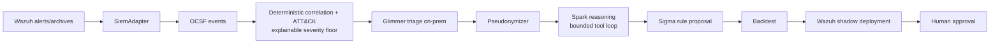
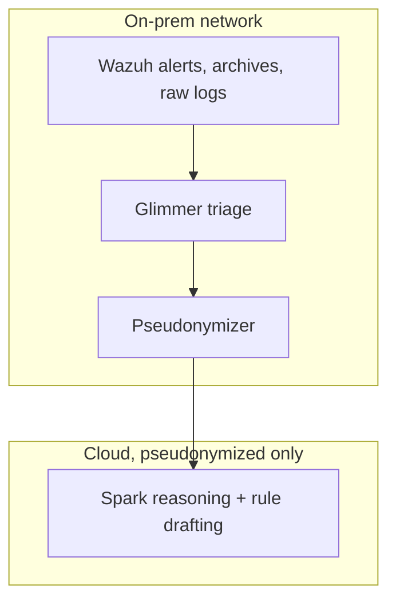

# Project Corvus

On-prem AI SOC analyst for small teams: it turns Wazuh alerts into a few explained attack chains, without logs leaving the network.

## The problem

Small teams run Linux servers and Windows endpoints with Wazuh as their only security tool and no 24/7 SOC. Existing AI SOC tools are enterprise-priced SaaS that require shipping raw logs to a vendor cloud. Real attacks stay buried in uncorrelated alerts.

## What it does

Corvus is not a SIEM. It plugs into the Wazuh SIEM the team already runs: Wazuh detects atomic events and stores logs; Corvus consumes alerts, correlates them into attack chains, reasons over them, and pushes learned rules back.

Pipeline, in order (`docs/architecture.md` has the module for each step):

1. Wazuh alerts and archives enter through a `SiemAdapter` (`corvus/adapters/wazuh/`, `corvus/adapters/replay/`). No raw log parsing in hackathon scope.
2. Alerts become OCSF events (pinned schema v1.9.0). There is no local event store: PostgreSQL is the system of record (incidents, queue, checkpoints, agent steps, rules, dispositions, pseudonyms, spend, LLM attempts; migration `corvus/state/migrations/0002_core_tables.sql`). The SIEM stays the log store, queried on demand.
3. Deterministic correlation (host, user, IP, process, time window) plus MITRE ATT&CK mapping (`corvus/correlate/`, `corvus/attack/`) builds candidate incidents with an explainable severity floor. The database keeps `severity_id` between the floor and one level above it, so models can never silently lower or raise scores.
4. Muse Glimmer triages each cluster on-prem through an async batch queue (`corvus/llm/triage_worker.py`). Glimmer alone sees raw evidence.
5. A pseudonymizer (`corvus/guardrails/pseudonymizer.py`) condenses and pseudonymizes the incident before any cloud call.
6. Muse Spark reasons over the pseudonymized incident in a bounded agent loop with two read-only tools (`get_events`, `get_attack_technique`) and returns verdict, timeline, and response in English or Spanish (`corvus/llm/agent.py`).
7. Proposed Sigma rules are backtested (`corvus/learning/backtest.py`), deployed to Wazuh in shadow mode (`corvus/learning/wazuh_xml.py`, `corvus/learning/shadow.py`), and need human approval (`corvus rules approve`). Promotion is never a model tool.
8. A reduced web UI (read-only API) and an eval harness sit alongside.

## Where Meta models are used

Stated exactly as the code does it (`corvus/llm/config.py`, `corvus/llm/prompts/triage.py`):

- On-prem triage: Muse Glimmer, served as model `glimmer` via vLLM at `GLIMMER_BASE_URL` (required, no default) on the team's own hardware. Default purpose config: output cap 4500 tokens, reasoning strength medium via `TRIAGE_REASONING_STRENGTH`, up to 16 concurrent queue workers. Glimmer reads raw evidence and produces the condensed incident.
- Reasoning and rule drafting: `muse-spark-1.3` at `META_BASE_URL` (`https://api.meta.ai/v1`) with `META_API_KEY`. Default purpose config: output cap 6000 tokens. Spark sees only condensed, pseudonymized incidents.
- `MODEL_PROFILE` selects the backend per purpose: `hybrid` (default), `all-local` (Glimmer serves both, no cloud key needed), `all-cloud`.
- Muse Code is the coding agent used to build this repo.

## Security by design

Every Spark call goes through the pseudonymizer; raw events never leave the on-prem path (`corvus/llm/call.py`, `corvus/guardrails/payload.py`). Supporting guardrails:

- Secret redaction of command-line passwords and tokens before any cloud call (`corvus/guardrails/egress.py`).
- Egress allowlist: the HTTP client only talks to the model endpoints and Wazuh; network-level egress stays the operator's firewall.
- Injection handling: a deterministic pattern detector (`corvus/guardrails/injection.py`) records injection attempts as incident signals; security-validator failures are quarantined, never retried.
- Spend cap (`SPEND_CAP_USD`, default 100.0) with degraded mode; every model attempt is recorded in `llm_attempts`.
- Shadow mode: learned rules run without notifying or changing severity until a human approves; rollback is one command (`corvus/learning/shadow.py`).
- Read-only UI/API: the API serves only `GET` routes plus the UI bundle (`corvus/api/main.py`). The UI has no login; expose it only behind your own access controls.

Details and attacker model: `docs/threat-model.md`.

### Known limitations

- Non-service usernames join incidents across hosts (`corvus/correlate/identities.py`), so a shared account name — including a name an attacker types into a failed login — links alerts into one incident.
- The pseudonymizer hides only entity-shaped spans of registered values; bare words with no recognizable shape pass through verbatim, as do novel encodings such as compressed payloads or short hex (`corvus/guardrails/pseudonymizer.py`).
- The pseudonymizer registers ordinary words it finds in free text as hosts, and a pseudonym-shaped string typed by an attacker passes through unchanged (`corvus/guardrails/pseudonymizer.py`, `tests/test_pseudonymizer_single_pass.py`).
- Values that are not mapped to a typed slot are kept whole under `unmapped` in the Windows and Wazuh normalizers; the 65536-character cap applies to typed slots and `raw_data` only (`corvus/normalize/windows.py`, `corvus/normalize/wazuh.py`).
- The UI has no login in hackathon scope.
- One-node PostgreSQL; no replica or failover.

## Results

Every number below names its producing report. Anything not yet measured is marked so explicitly.

| What | Number | Source |
|---|---|---|
| Replay load, APT29 day-1 file | n=196081 records, 152491 mapped, 43590 unmapped | `eval/reports/apt29_day1_replay_load.md` |
| Full eval, rules evaluated | n=1792 of 2240 parsed (rest skipped by logsource, status, event id, field) | `eval/reports/latest.md` |
| Full eval, chain coverage (APT29 day-1, n=10 steps) | best incident covers 8, all incidents cover 8 | `eval/reports/latest.md` |
| Full eval, atomic technique match | n=53 of 110 in-store files with ground truth (48 exact, 5 parent-only) | `eval/reports/latest.md` |
| Full eval, benign false positives (declared synthetic, n=312) | n=4 incidents, 0 at Critical or above (gate) | `eval/reports/latest.md` |
| Model path, Glimmer first-pass validity | 0.8839 over n=112 triage calls | `eval/reports/llm_latest.md` (measured on 2026-11-01 by a local run; the report is regenerated by `corvus eval llm` and is not committed) |
| Model path, Spark cost | USD 0.043796 per resolved incident (n=5) | `eval/reports/llm_latest.md` (measured on 2026-11-01 by a local run; the report is regenerated by `corvus eval llm` and is not committed) |
| Model path, day-1 timeline coverage | best 7 of 10 steps, all 9 of 10 | `eval/reports/llm_latest.md` (measured on 2026-11-01 by a local run; the report is regenerated by `corvus eval llm` and is not committed) |
| Linux shipped rules measured | n=149 inventoried, 73 evaluate, 7 baseline matches on 7 events (n=55794) | `eval/reports/linux_rules_measured.md` |
| Linux benign baseline census | n=157451 documents, no attack content | `eval/reports/linux_baseline_census.md` |

Not yet measured: alert-to-incident reduction ratio on live data; injection-robustness score on the current model path; end-to-end latency per incident; live-run precision of a shadow rule promoted to active; Glimmer throughput on the deploy GPU. These rows stay empty until a committed report produces them.

## Quickstart

`corvus version` prints the package version (verified here: `0.1.0`).

From a clean clone:

1. Copy `.env.example` to a file outside the repository and fill in secrets. Compose refuses to start when `CORVUS_ENV_FILE` is unset (verified here: `docker compose config` with it unset fails on all three services).
2. `CORVUS_ENV_FILE=/run/corvus/corvus.env docker compose up --build -d` (not verified here; needs real secrets).
3. `corvus db migrate` applies pending SQL migrations (reads `DATABASE_URL`; verified here against scratch database `corvus_test_docsfix` on port 55432, then dropped).
4. `curl http://127.0.0.1:8000/health` reports database and model reachability (not verified here; needs a running stack).
5. Fetch public datasets: `python3 scripts/fetch_datasets.py`, then `python3 eval/ground_truth.py --out data/ground_truth.json` (see `datasets/README.md`; downloads pinned revisions with SHA-256 checks; not verified here; large downloads).
6. Replay demo: `corvus replay load-linux` plus `corvus correlate replay` ran end to end here on a tiny 3-record archive built from `tests/fixtures/linux` (3 events, 3002x2 and 1007x1; correlate stored 0 incidents). Plain `corvus replay load` and `corvus replay detect` need the datasets from step 5. Help verified here: `corvus replay load -h`, `corvus replay detect -h`, `corvus correlate replay -h`, `corvus analyze -h`.
7. `make lint` (ruff check, ruff format check, mypy; verified here, green) and `make test` (full pytest, not run in this lane; the migration test requires `DATABASE_URL=postgresql://127.0.0.1:55432/corvus_test_<name>`; test recipe in `AGENTS.md`).

## Demo

Three-minute judge script: `docs/demo.md`. It walks the incident list, one explained chain with its evidence, the pseudonymized view the cloud model sees, and the learned rule in shadow mode with its lineage, naming the exact screen and command for each step.

## Data policy

Only public datasets (OTRF Security-Datasets, EVTX-ATTACK-SAMPLES) or lab-generated data. No customer data, no real names. Most fixtures use reserved documentation ranges and private lab ranges with `example.com`. The Linux corpus (`tests/fixtures/linux/sshd_real_corpus.jsonl` and the tests that use it) is real traffic from our own lab and may contain public addresses of lab hosts and of the people who logged in. Datasets are fetched with checksums and never committed.

## Built during the hackathon

All product code in this repo has been written since Oct 26, 2026, for the Meta Global AI Developer Hackathon. The commit history shows what was built when.

## License

AGPL-3.0 (see [LICENSE](LICENSE)). Third-party notices: [NOTICE](NOTICE) (MITRE ATT&CK, SigmaHQ rules, OCSF schema).
